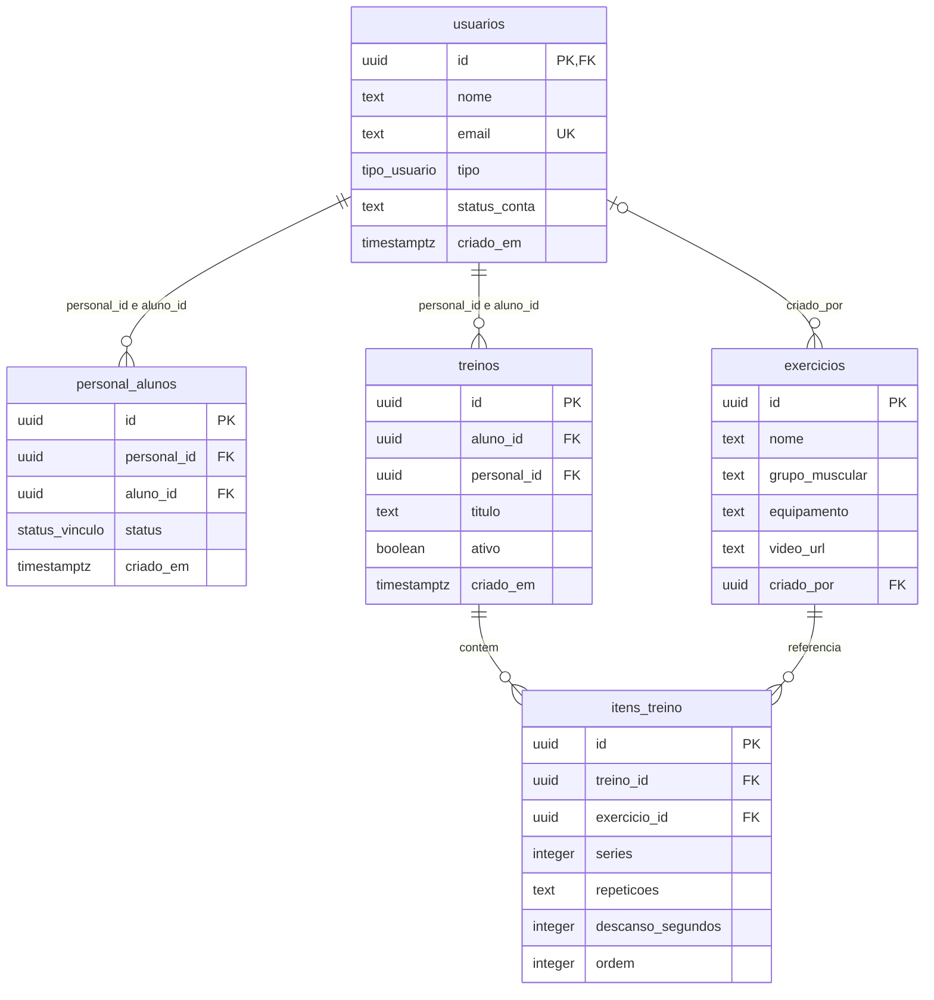
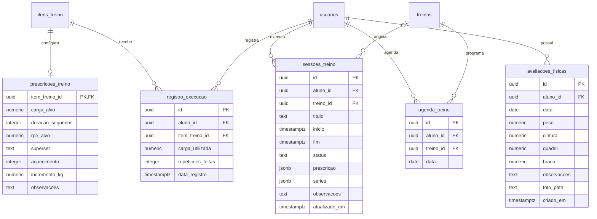
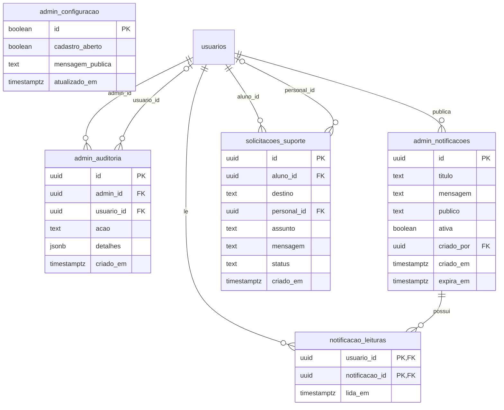

# Diagrama de Entidade-Relacionamento — ShapeOS

Atualizado em 19/10/2026 a partir das tabelas e chaves estrangeiras verificadas no banco de produção. Os diagramas representam partes do mesmo modelo, com 15 tabelas públicas. A repetição de usuarios/treinos/itens em módulos é apenas referência à mesma entidade.

usuarios.id também referencia auth.users.id (1:1). auth.users e os hashes de senha são gerenciados pelo Supabase Auth, fora das tabelas de negócio.

## Núcleo: usuários, vínculos e fichas

Cada vínculo associa um Personal e um Aluno; o par é único e não pode se vincular a si mesmo. A posição é única por ficha. Nome/grupo muscular de exercício também são únicos. tipo pode ser PERSONAL, ALUNO ou ADMIN; status_conta pode ser ATIVO, PENDENTE ou BLOQUEADO.

## Prescrição, execução e acompanhamento

prescricoes_treino é uma extensão opcional 1:1 de um item. A agenda possui unicidade por aluno/ficha/data. A sessão guarda snapshots JSON da prescrição e das séries para preservar o histórico mesmo quando a ficha é excluída; nesse caso treino_id fica nulo. Os registros legados de execução associados a um item removido seguem a exclusão em cascata.

## Administração e notificações

admin_configuracao é uma configuração singleton sem chave estrangeira. notificacao_leituras tem chave primária composta; a view notificacoes_recebidas combina notificações visíveis e leituras, sem ser uma tabela adicional.

## Suporte

solicitacoes_suporte contém id (PK), aluno_id (FK usuarios, obrigatório), destino, personal_id (FK usuarios, opcional), assunto, mensagem, status e criado_em. Um aluno pode abrir várias solicitações; cada solicitação pode ser encaminhada a um personal ou ao suporte administrativo. A migração 20261019144715_sprint3_support_schema.sql reproduz essa tabela em instalações novas, sem alterar os registros e políticas de instalações existentes.

Todas as 15 tabelas estão com RLS habilitado. Chaves e cardinalidades descrevem o banco; acesso a registros continua condicionado às políticas e ao perfil autenticado.
